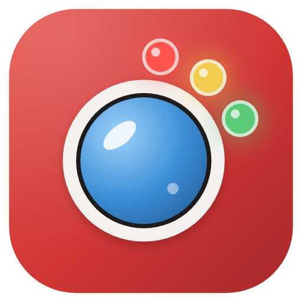
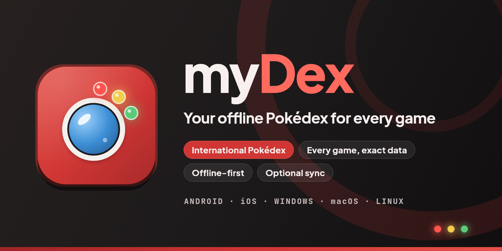

# myDex brand and design system



## Mark

The **lens with three signal LEDs** – the essence of a Pokédex casing, without copying any
trademarked design. The LEDs orbit the lens towards the top right; the whole mark stays inside
its inscribed circle, so it survives every icon mask (circle, squircle, teardrop) and the
Android adaptive-icon safe zone.

- Single source: `apps/pokedex/lib/brand/brand_mark.dart` (`BrandPainter`). The app, the
  animated loading screen and every platform icon are drawn by this painter.
- Variants: full icon on the red casing, mark alone (`mark.png`), single colour
  (`mark-monochrome.png`, Android 13+ themed icons).
- Word mark: “my” in the text colour, “Dex” in brand red, Plus Jakarta Sans ExtraBold.

### Regenerating the icons

```sh
cd apps/pokedex
flutter test tool/brand/generate_icons_test.dart   # all PNGs, splash images, Linux icons
python3 tool/brand/finalize_icons.py                # Windows .ico, opaque iOS icons (Pillow)
```

| Platform | Output |
|---|---|
| Android | `mipmap-*/ic_launcher*.png` (legacy, round, adaptive layers, themed), `drawable-*/splash_icon.png` |
| iOS | `AppIcon.appiconset` (opaque), `LaunchImage.imageset`, `LaunchBackground` colour set |
| macOS | `AppIcon.appiconset` on the macOS icon grid with shadow |
| Windows | `windows/runner/resources/app_icon.ico` (16–256 px, each size drawn natively) |
| Linux | `linux/packaging/icons/hicolor/*`, window icon `linux/runner/resources/app_icon.png` |

### GitHub social preview



`social-preview.png` (1280 × 640, under 1 MB) is the repository's link preview: the app icon,
the word mark, the tagline and the platforms on the dark hinge colour, drawn by the same
`BrandPainter` with the bundled fonts. It deliberately contains no Pokémon artwork.

```sh
cd apps/pokedex
flutter test tool/brand/social_preview_test.dart   # → docs/brand/social-preview.png
```

GitHub does not take it from the repository automatically: upload it under
**Settings → General → Social preview**.

## Colour

| Token | Value | Use |
|---|---|---|
| Brand red | `#CF3634` | Primary, casing, splash (4.9:1 against white) |
| Red dark | `#9E2426` | Gradients, pressed states |
| Hinge | `#1D1A1B` | Digital number display, dark accents |
| Lens | `#3D8FD6` → `#9FD2FA` | The mark only |
| LEDs | `#FF544D` `#F2CC4E` `#5CCB78` | The mark, status dots |
| Display | `#8BF0A6` | Digits of the Pokédex number |

Surfaces are neutral and slightly warm; colour comes from the content: every Pokémon tints its
header and cards with the main colour of its artwork, types keep their established colours and
always carry their name.

## Typography

- **Plus Jakarta Sans** (400–800) for the whole UI – geometric, friendly, legible when small.
- **JetBrains Mono** Bold for the digital Pokédex number (`#0025`).
- Both under the SIL Open Font License, bundled (offline) and listed in the app's licenses.

## Motion

Principles: motion explains where things come from and confirms actions; it never delays.

| Token | Duration | Use |
|---|---|---|
| `Motion.short` | 160 ms | Toggles, icons, colours |
| `Motion.medium` | 300 ms | Switchers, sections, sheets |
| `Motion.long` | 500 ms | Entrances, hero header colour |
| `Motion.reveal` | 800 ms | Stat bars, progress |

Curves: Material 3 emphasized decelerate (enter), emphasized accelerate (exit), standard.

Patterns:

- **Hero flight** of the artwork from the list into the detail page.
- **Fade through** between sections of the app and between list/detail content.
- **Staggered entrance** of list items and detail sections – only items that appear right after
  a change take part, scrolling is never slowed down.
- **Gliding values**: stat bars, header colour and progress ring animate to new values when the
  game changes, so differences between games become visible.
- **Confirmation pop** with haptics when marking a Pokémon as seen, caught or shiny.

Every animation is finite and respects *reduce motion* – the system setting or the app's own
switch under *More → Appearance*. Then all durations become zero.
